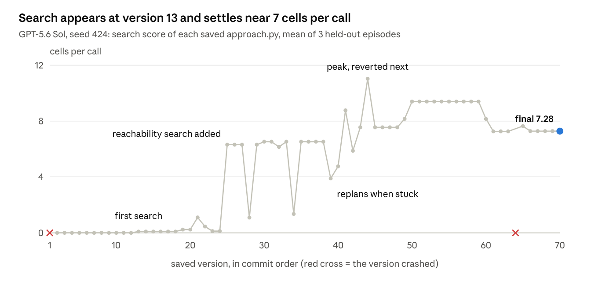

# Measuring Planning in Agent-Written Policies: the Abstract-Tree Analyzer

Last updated 13 November 2026.

## Problem statement

The analyzer measures how much an agent-written robot policy plans by search, and backs each claim with experiments on the running code.

**Given**

- a policy P: a Python class with `reset(s0, info)` and `get_action(s)` that keeps memory between calls;
- an environment E with states S, actions U and deterministic transitions. Here it is KinDER ClutteredRetrieval2D, where one action moves the robot at most 0.05 m per axis;
- episodes: one `reset` call, then action calls until success or a step limit.

**Find**, for every part ℓ of P, one of three verdicts. A part is a `while` loop, a `for` loop that no other loop of its function encloses, a function that calls itself, or a call to a library graph search:

1. **search**: one explanation h from a fixed hypothesis class reproduces every iteration of every run of ℓ. It must do so on development episodes, on held-out episodes, and under interventions.
2. **not a search**: no explanation applies, and the loop shows no to-do-list (worklist) behaviour.
3. **unknown**: the loop might be a search the class cannot express. Unknown is never counted as zero.

**Then measure** three things for P: how much it searches, how far ahead it looks, and whether search results decide its moves.

**Out of scope**: solution quality and efficiency; reading planning that is not best-first search over the policy's own grid cells (sampling planners, searches inside library calls), which is detected and reported as unknown but not measured; and whether the policy's internal map matches the real world. That last check is part of the method but not built yet (section on the method).

## Running examples

Three policies carry the explanations below: a simple planner, a decoy that looks the same from outside, and a real agent-written policy.

**plan\_once** (a disc-world control). At `reset` it runs A\* over a 0.1 m grid, stores the path in `self.path`, and every action steers to the next waypoint. Its search loop:

```python
frontier = [(0.0, root)]
cost, parent = {root: 0.0}, {root: None}
while frontier:
    _, cur = heapq.heappop(frontier)
    if cur == target:
        break
    for di, dj in ((1, 0), (-1, 0), (0, 1), (0, -1)):
        nxt = (cur[0] + di, cur[1] + dj)
        if not free(nxt):
            continue
        nc = cost[cur] + math.hypot(di, dj)
        if nc < cost.get(nxt, 1e30):
            cost[nxt], parent[nxt] = nc, cur
            h = math.hypot(nxt[0] - target[0], nxt[1] - target[1])
            heapq.heappush(frontier, (nc + h, nxt))
```

Expected answer: one search, whose plan drives every later step. Measured: search score 2.6 per call, followed-plan share 1.0.

**discarded\_search** (a decoy control). It runs exactly the same search, then throws the path away and stores two waypoints at the goal instead. From outside it looks like plan\_once: same search, same effort (search score 2.6), and a stored plan the robot follows. The correct followed-plan share is 0. This is why plan use must be proven by intervention, never inferred from a search being present.

**GPT-6 Astra, seed 444** (an agent-written KinDER policy of 350 lines; solves 3 of 3 held-out episodes). At each decision point it tries up to 36 grasp options per object. For each option it runs an approach A\* and a carry A\*, then keeps the cheapest. Its A\* uses a 2% inflated octile distance estimate, diagonal steps of 1.414, a numpy obstacle grid, and it smooths the stored path down to its corners. The fixed ingredient menu could not read it, so ingredients are now fitted from data. Measured: search score 428.7 per call, followed-plan share 0.03–0.37.

## The idea in plain words

To claim that a loop is a search, the analyzer runs its own copy of a search beside the loop and shows that the two match exactly. That copy builds its own tree of parent links, the **abstract tree**, which gives the branch its name.

Think of a student solving a maze. Watching them once proves nothing; predicting each next step from a stated rule, before seeing it, does. Proving the solution drove their walking takes more: secretly move a wall, then check that both their answer and their walking change.

The analyzer works in these steps, for each policy:

1. **Record.** Run practice (development) episodes. At every pass through every part (each `while` loop, each outermost `for` loop of a function, each call of a function that calls itself), save a snapshot of its local variables. The policy's clock is simulated, so a search with a time budget runs the same while it is recorded.
2. **Propose.** Read candidate ingredients off the snapshots: which variable is the to-do list, the parent table, the cost table; the move costs, the distance estimate, the obstacle grid.
3. **Check.** Run the copy step by step from each run's first snapshot. It must reproduce every later snapshot exactly, without ever looking at it.
4. **Probe.** Edit the running loop (remove a to-do entry, raise a cost, block a cell) and require the copy to predict what happens next. Copies that mispredict are dropped.
5. **Freeze.** Keep the surviving explanation with the most search, and save it before seeing any new episode.
6. **Validate.** On new (held-out) episodes, repeat the check and the probes with the frozen explanation.
7. **Trace plans to moves.** When a search's result is stored as a plan, change the search and require the stored plan, then the robot's moves, to change as predicted.
8. **Measure.** Report search amount, look-ahead and plan use, computed only from held-out episodes.

A loop no explanation fits is not assumed harmless. If it looks like it keeps a to-do list, or cannot be fully seen, it is reported as unknown (so is every call to a library graph search), and every total it could change is shown as a lower bound (≥).

## Formal model

An explanation is a fixed search algorithm with chosen ingredients plus a map from the policy's variables to the algorithm's state. It holds when the algorithm, run on its own, reproduces the policy's loop at every checkpoint.

### Policy, calls, runs

The policy keeps memory m across calls. Call 0 is `reset`; calls 1 to T are actions:

```math
(m_k, a_k) = P(m_{k-1}, s_k), \qquad k = 1, \dots, T
```

A **part** ℓ is a `while` loop, a `for` loop that no other loop of its function encloses, a function that calls itself, or a call to a library graph search. Each execution of ℓ inside a call is a **run** r; for a function that calls itself, one run spans its outermost call. A run has checkpoints t = 0, 1, …, n: one before every loop test (for a `for` loop, at the start of each iteration's body), and one at its end (a false test or `break`, or a `return` inside the loop). The **snapshot** x\_t holds the function's local variables at checkpoint t. Only loops are matched against the abstract program below. A recursive part is checked only for signs of a hidden search, and a library call is always unknown (section on loops the analyzer cannot read).

### Abstract search program

The abstract state is z = (ρ, F, π, g, φ): root cell ρ ∈ ℤ², frontier F (a heap or an ordered list of entries), parent map π (the **abstract tree**, π(ρ) = ⊥), cost map g, and phase φ ∈ {ready, done}. One step of Q\_θ:

1. If F is empty, set φ = done.
2. Take the best entry e with cell v: lowest priority for a heap (ties broken by the entry's stored numbers), first or last for a FIFO or LIFO list.
3. Goal tested at selection: if v = γ, set φ = done.
4. Stale entry (skip rule): if e's priority exceeds rank(v), the step ends.
5. Expand v: for each move (di, dj, c) in order, w = v + (di, dj). Skip w if the model says it is blocked, or if the move is diagonal, corner cutting is off, and a side cell is blocked. Let g′ = base(v) + c, where base(v) is g(v) or the cost stored in e. If w is new, or known with g′ < g(w) under the improve rule: set π(w) = v, g(w) = g′, and push (rank(w), stored numbers, w). Goal tested at generation: if w = γ, set φ = done.

The priority and the distance estimate, with a = max(|Δx|, |Δy|) and b = min(|Δx|, |Δy|) the cell distances to γ:

```math
\mathrm{rank}(w) \in \{\, g(w),\; g(w) + h(w),\; h(w) \,\}, \qquad h(w) \in \{\, 0,\; \sqrt{a^2 + b^2},\; a + b,\; \omega (a + \kappa b),\; \omega \sqrt{a^2 + b^2} \,\}
```

### Mapping and alignment

The mapping α names which local variable holds the root, frontier, parents, costs, goal and obstacle model, and reads them off a snapshot. A heap frontier is compared as a sorted multiset of (priority, cell); an ordered list keeps its order. An explanation h = (θ, α) explains a run when:

```math
z_0 = \mathrm{bind}_h(x_0), \qquad z_{t+1} = Q_\theta(z_t), \qquad \alpha(x_t) \approx z_t \quad (t = 0, \dots, n)
```

and the run ends exactly at the checkpoint where φ becomes done. Here ≈ means: root, parent map and frontier cells equal; costs and priorities equal within 10⁻⁹ (relative or absolute). Q computes z\_{t+1} from z\_t alone and never reads x\_{t+1}, with one legacy exception for ties (see Limitations).

### Per-run features

N = distinct cells expanded; M = max(N − 1, 0); expansion events = expansions including repeats; depth(v) = length of the parent chain from ρ to v; max expanded depth = the largest depth among expanded cells.

## Finding explanations

Explanations are proposed from development episodes only, by binding variables to roles and choosing ingredients, then kept only if they reproduce every development run.

### Bindings

At the first checkpoint of every development run of a loop, a binding assigns roles to local variables:

- **root**: a cell, a pair of integers;
- **frontier**: a list or deque holding exactly the start, as one entry (priority, …, root) or the bare root;
- **parents**: `{root: None}`, or an empty dictionary (the method's own algorithm stores no parent for the root);
- **costs**: `{root: 0}`;
- **goal**: another cell;
- **obstacle model**: a policy function that returns a bool for the root, or a 2-D boolean grid that contains the root.

A binding must hold in every development run. The search is bounded: at most 1,024 variable paths inventoried, nesting depth 3, 64 bindings.

### Ingredients

| Ingredient | Options | How chosen |
| --- | --- | --- |
| Selection | lowest priority (heap), FIFO, LIFO | enumerated |
| Priority | g, g + h, h | enumerated |
| Distance estimate h | straight-line, city-block; or fitted ω(a + κb), ω·straight-line | fitted from pushed entries |
| Moves and step costs | 4 or 8 moves at length √(di² + dj²); or a fitted table | fitted from new parent links |
| Root priority | 0, or rank(root) | enumerated |
| Goal test | at selection, at generation, none | enumerated |
| Cost updates | keep first parent; or improve when cheaper | enumerated |
| Stale heap entries | expand again; skip | enumerated |
| Obstacle model | policy function; boolean grid (True = free, or True = blocked); none | enumerated |
| Corner cutting | allowed; not allowed | enumerated |
| Cost used to expand | cost table; number stored in the entry | enumerated, separated only by interventions |
| Entry's stored numbers | g, −g, or a push counter | fitted |

### Fitting

Fitted values come from the first 64 checkpoints of each development run. Each constant is snapped to the shortest decimal that reproduces every observed number exactly, so 1.414 rather than 1.4139999999999997, and the copy repeats the policy's own arithmetic. Unseen straight or diagonal moves get their kind's cost when all observed moves of that kind agree. A fit equal to a menu item is written as that item, and duplicate proposals are tested once.

### Acceptance and selection

An explanation survives if the alignment condition holds on every development run. Development probes (next section) then remove survivors that mispredict an edit. Of those left, **the one with the largest mean M over development runs is selected** (ties by identifier). At most 6,000 candidates are tested per policy. The bank (survivors, selection, plan readouts) is saved before any held-out episode runs.

**Astra, concretely.** One binding: frontier `front`, parents `parent` (empty at start), costs `cost`, goal `dst`, obstacle grid `bad`. Fitted: 8 moves at 1.0 and 1.414, h = 1.02(a + 0.414b), entries store g. Of 888 candidates, 4 reproduce all 100 development runs. Probes leave one: it reads the cost from the entry and skips stale entries, exactly as Astra's code does.

## Interventions and held-out validation

An intervention edits the running loop and the copy in the same way, and the explanation must keep matching afterwards. The same probes run twice: on development episodes to choose an explanation, and on held-out episodes to test it.

### The condition

An edit J of the abstract state has a concrete counterpart L\_J applied to the live variables at checkpoint t. Both must agree, and the edited run x′ must then follow the copy from the edited state z′:

```math
\alpha\big(L_J(x_t)\big) = J\big(\alpha(x_t)\big), \qquad z'_{s+1} = Q_\theta(z'_s), \qquad \alpha(x'_s) \approx z'_s \quad (s \ge t)
```

Checkpoints before the edit must replay unchanged; otherwise the probe is void.

### The edits

| Edit | What it changes | What it tests |
| --- | --- | --- |
| Drop | removes one to-do entry at a random checkpoint | the frontier is the real to-do list |
| Raise | adds 2.0 to the stored cost of a waiting cell | the cost table steers later choices |
| Clear | empties the to-do list | the search's end and its fallback |
| Raise next | adds 2.0 to the cost of the cell about to be expanded | whether expansion reads the cost table or the entry |
| Detour | removes every entry of one cell on the stored path, just before its first expansion | the stored plan comes from this search |

The detour cell is chosen from the first three interior cells of the stored path, or from a corner a smoothed plan kept. It must keep the endpoint reachable according to the explanation.

### How many

Per loop and episode, at most 8 runs are probed: first the runs that stored a new plan, then seeded random picks. Each probed run gets 5 random edits (2 drops, 2 raises, 1 clear, at seeded checkpoints), the targeted raise, and its detours. Every edit re-runs the whole policy call from a deep copy. An edit run once serves every explanation being probed.

### Development versus held-out

In development, all surviving explanations are probed and any misprediction drops one. On held-out episodes, the frozen explanation is probed and a misprediction marks that run rejected. Development episodes are (obstacles, seed) = (1, 0), (3, 1), (5, 2). Held-out episodes are (3, 100), (15, 101), (20, 102), weighted equally. Sol's author designed for 1, 3, 5 and 10 obstacles, so 15 and 20 lie beyond its design.

Each held-out episode runs three times: plain, counting, and fully analysed. The actions must be identical across the three, which shows recording does not change behaviour. A run ends **supported** (every checkpoint and probe matched), **rejected** (a counterexample), or **unresolved** (no applicable explanation, for example a loop first seen on held-out data).

Held-out testing is needed because ingredients are fitted to development data, so passing there proves little. On the Astra-style test policy, the version that reads costs from the table passed every development check; a held-out probe rejected it.

## From search to action

A search counts as driving the robot only through a tested chain: an edit to the search predicts the new stored plan, and that plan alone predicts the changed move.

### Stored plans and following

A **plan** is any policy attribute holding a list of 2-D points. A new **plan version** starts when a call replaces that content; consuming waypoints from its head does not. A version copied verbatim from another attribute, in a call where no search produced it, takes that attribute's verdict.

Every action step gets a cheap **following test**: rotate each stored plan 90° about the robot and re-run the step. The plan is followed if the new move points 90° from the old one (cosine ≥ 0.9). Shifting every obstacle 0.05 m and getting the same move marks the step **world-insensitive**.

### Readout: from the abstract tree to a predicted plan

A cell becomes a waypoint through a policy function, or through a policy array read as point\[i, j\]. With c₀ = ρ and cᵢ = π(cᵢ₊₁), the **complete readout** of a chain ending at endpoint cₙ is:

```math
\text{plan} = \big(\mathrm{point}(c_s), \dots, \mathrm{point}(c_n),\ \text{tail}\big), \qquad s \in \{0, 1\}
```

The tail is an optional final point after the last cell, or in place of it. The **partial readout** (used only when no complete readout reads a development plan) accepts an ordered subset of the chain to the goal. It must keep at least one cell before the goal, and its final point must lie inside the goal cell. That is how a smoothed plan is stored.

### Judging an edited plan

- The edit lost the endpoint: unresolved.
- Complete readout: the observed plan equals the prediction, go to the replay; it differs while the endpoint was kept, **rejected** (a counterexample).
- Partial readout: the plan changed and lies in order on the edited path to the same goal, go to the replay; otherwise unresolved. Smoothing is not modelled, so this is weaker than an exact prediction.

### The four-copy replay

For up to 32 later action calls, four copies of the policy receive the same observations:

| Copy | Starts from | Must produce |
| --- | --- | --- |
| Baseline | the ordinary policy | the ordinary actions |
| Search edit | the policy after the edited call | a changed action at some call |
| Plan only | ordinary policy with the predicted plan installed | the same action as search edit |
| Restored | edited policy with the ordinary plan installed | the ordinary action |

All four holding is a **witness**. A plan-only or restored mismatch is a counterexample: the plan does not carry the effect. The replay stops unresolved if a recognised search runs again, the plan is replaced, or 32 calls pass with no change.

### Verdicts and step categories

A plan version is **witnessed** if any chain is witnessed, **disproved** if every applicable chain is rejected, **unmatched** if no readout applies, and **unresolved** otherwise. Each action step falls in exactly one category: ran a search; followed a plan (witnessed, unresolved, disproved or unmatched); unresolved loop (an unknown loop ran, no plan evidence); or neither.

**Astra, concretely.** Blocking a corner its smoothed plan kept made the search route around it, Astra stored different corners, and that plan alone reproduced the changed move: a witness in the 15- and 20-obstacle episodes. When the straight line to the goal is clear, Astra stores only the goal. Such a plan carries no route and stays unmatched.

## Loops the analyzer cannot read

A part with no binding counts as zero search only if it shows no sign of being a hidden search; otherwise it is **unknown**, and every total it could change is withheld. A call to a library graph search (in scipy.sparse.csgraph, networkx or skimage.graph) is always unknown, because its search runs in compiled code.

Any one of seven signs makes a loop or a recursive function unknown:

1. **Churn.** Some container both gains and loses items during the run. A variable that is only ever replaced by a new container of the same size (a point or pose rebuilt each round) is a value, not a container. Containers nested inside others always count. Variables that cannot carry items from one pass to the next are skipped: a `for` statement's own variables, variables rebuilt from a new value before any use in each pass, and variables that an explained search nested inside the loop accounts for.
2. **A growing sequence with a read cursor.** A list grows while an integer that the part's code reads advances and stays strictly behind its end, as in a breadth-first search with a head index. A counter equal to the length has nothing left to read, so it is not a cursor.
3. **A wavefront.** A 2-D boolean grid changes only by growing by its own neighbours (every new True cell touches an old one), at least three times in one run. This is breadth-first search kept as a reached grid instead of a queue.
4. **A `for` loop over a list it appends to.** `for cur in queue: … queue.append(nxt)` also visits the appended items, so it is breadth-first search with Python's hidden position as the cursor.
5. **Random draws with hidden state.** One pass draws random numbers and changes state that snapshots do not hold: a numeric array of more than 64 numbers, or a container or object among the attributes of the policy's own objects. This is how a sampling planner grows a tree kept in numpy arrays or a `Tree` object. Draws count only for the innermost loop running, and single numbers (a call counter) are not hidden state.
6. **A snapshot omission.** A container that cannot be recorded by value, because it holds objects next to lists or dicts, changes which items it holds during the run. A container of plain objects is followed by item identity and size instead, so a queue of node objects that pops one and pushes another still shows churn.
7. **An inspection cut.** More than 4,096 containers, or containers nested deeper than 4.

The test is repeated on every held-out run: a loop that was “not a search” in development is unknown on any held-out run that shows a sign.

An unknown run counts as unresolved. Totals are withheld and shown as “≥ the explained part”, because an unknown run can only add search. The followed-plan share's maximum includes steps where an unknown loop ran. Unknown is never counted as zero.

These are bounded tests, not proofs. Two kinds of search still give no sign and count as zero by mistake: a recursive depth-first search that never backs up (see Limitations), and a deterministic search that keeps its to-do list in a large numpy array or a `self` attribute.

**Astra, concretely.** Its smoothing loop appends one point per round while its index i equals len(result). An earlier version of the cursor rule accepted equality and flagged 22 runs as unknown; the strict rule reads all of them as “not a search”.

Watching `for` loops at first made Astra's candidate loop unknown too. Its candidate list holds objects, and `_`, a component count the loop only assigns, looked like a cursor. Following objects by identity, and requiring a cursor to be read, removed both.

## Measurements

Every number is computed per held-out episode from supported runs and classified steps, then averaged over the three held-out episodes with equal weight. T is the number of action calls; calls are indexed k = 0 (reset) to T.

### Key formulas

```math
\text{search score} = \frac{1}{T+1} \sum_{k=0}^{T} \max\Big(\sum_{r \in k} N(r) - 1,\ 0\Big)
```

```math
\text{followed-plan share} \in \Big[\frac{W}{T},\ \frac{W + U + L}{T}\Big], \qquad \text{searched share} = \frac{S}{T}
```

W, U, L and S count steps that followed a witnessed plan, followed a plan of unresolved provenance, ran an unknown loop with no plan evidence, and ran a search. Disproved and unmatched plans count in neither end.

```math
\text{look-ahead in robot steps} = \frac{\bar{d} \times \text{cell size}}{0.05\ \text{m}}
```

Here d̄ is the mean, over search runs, of each run's max expanded depth in cells, and 0.05 m is the largest move per action.

### All metrics

| Metric | Definition | Unit |
| --- | --- | --- |
| Search score | mean over calls of distinct cells expanded beyond the start; searches in one call are summed; a call without a search scores 0 | cells per call |
| Planning events | search runs that expanded at least one cell | runs |
| Expansion events | all expansions, repeats included | cells |
| N | distinct cells expanded, summed over runs | cells |
| At initialization | expansion events in the reset call | cells |
| Max expanded depth | longest parent chain to an expanded cell, over all runs | cells |
| Max discovery depth | the same for generated cells | cells |
| Re-expansions | expansion events minus N | cells |
| Cost improvements | times a known cell's cost was lowered | count |
| Generated alternatives | children generated by expansions | count |
| Followed-plan share | the range above | fraction of steps |
| Followed plan: witnessed, unresolved, disproved, unmatched | steps per plan verdict | steps |
| Searched share | steps that ran a search | fraction of steps |
| Unclassified loop, neither | steps with an unknown loop and no plan; steps with neither | steps |
| Attributed to actions | expansion events of runs whose plan was witnessed, or whose edit changed the same call's action; “≥” when some runs lack a witness | cells |
| World-insensitive share | witnessed steps whose move is unchanged when obstacles shift 0.05 m | fraction |
| Complete | no search-shaped run left unresolved | yes or no |
| Solved | episodes that reach the goal, reported separately | episodes |
| Look-ahead per search (planned) | d̄ in cells, metres or robot steps | see formula |
| Area explored (planned) | N × cell area | m² |
| Searches per planning call (planned) | planning events ÷ calls that ran a search | runs per call |

The last three are computed in this document but not yet printed by the analyzer.

### Withheld totals

If any search-shaped run in an episode is unresolved, its totals are withheld. The reports then print “≥” with the total over explained runs, a true lower bound because an unknown run can only add search. A mean across episodes is withheld if any episode's value is, with the mean of explained parts as its lower bound.

## Discussion of the metrics

No single number captures planning, so the reports should be read as a profile of four questions: how much a policy searches, how far ahead, how many options per decision, and whether its plans drive its moves.

| Question | Metric | GPT-5.6 Sol | GPT-6 Astra |
| --- | --- | --- | --- |
| How much? | search score | 7.3 cells per call | 428.7 cells per call |
| How far ahead? | look-ahead per search | 0.74 m, about 15 robot steps | 1.05 m, about 21 robot steps |
| How many options per decision? | searches per planning call | about 2 to 5 | about 22 to 35 |
| Do plans drive moves? | followed-plan share | 0.14–0.25 | 0.03–0.37 |
| Context | episodes solved | 0 of 3 | 3 of 3 |

### Effort, use and look-ahead measure different things

- **Effort** (search score, planning events, expansions) is exact when every loop is read. It counts wasted search in full: discarded\_search scores 2.6, the same as plan\_once. It also rewards inefficiency, since a flood fill explores everything and a good distance estimate explores little. The method itself says its score “measures search amount, not search quality”.
- **Use** (followed-plan share) catches wasted search but needs proof, so it is a range. Its lower end depends on how many searches get probed and on what the readout can read.
- **Look-ahead** (depth) is the closest to “looking into the future”. It also depends on the task: a short trip needs only a shallow search, so policies must be compared on the same episodes.

### Units

Cells are each policy's own invention: Sol's are 5 cm wide, Astra's 2.5 cm. In cells, Astra looks 2.8 times further than Sol (42 against 15); in metres the factor is 1.4. Robot steps use the largest move per action, 0.05 m, which is the same for every policy in this environment. They read as “how many moves ahead”.

### Normalisation

Per call, as the method defines its score, a long failing episode adds many zero calls. Per search, the two policies are close (Sol 400, Astra 449 cells). Per episode depends on episode length, and per planning decision shows how many options are weighed. Per call also weights episodes unequally when their lengths differ. Sol runs every held-out episode to its step limit, so a cell in its 3-obstacle episode counts about 4.4 times more than one in its 20-obstacle episode, and 69% of its final score comes from the 3-obstacle episode.

### Why Sol against Astra is not yet a fair comparison

1. **Grid size.** An Astra cell covers a quarter of a Sol cell's area.
2. **Failing episodes.** Sol solves none of the three held-out episodes and runs to the step limit (750, 2,550 and 3,300 steps). Its 20-obstacle searches are 127 one-cell searches by a stuck robot.
3. **Probe budget.** Astra runs 22 to 316 searches per episode, Sol 11 to 127. With 8 probed runs, most of Astra's plans stay unproven.
4. **Straight-shot plans.** A plan holding only the goal earns no credit, although which goal was chosen came from comparing searched routes.
5. **Choices are not credited.** Neither this analyzer nor the method credits choosing among options by their search results, which is Astra's main planning act. A choice probe would: lengthen one option's searched route and check whether the policy picks another.
6. **Overlap.** Area explored repeats the same floor: Astra explores 86 m² per episode in a 6.25 m² room.
7. **Readable searches only.** A search the analyzer cannot read turns every total into a lower bound.

Recommendation: report the profile above, with search score, look-ahead in robot steps and searches per planning call next to the followed-plan range.

## Assumptions

Every result above rests on these 28 assumptions; each is a design choice or a bound that could be changed.

### Policies and environment

- **A1.** Policies are trusted Python code, run in-process with no sandbox.
- **A2.** A call is reproducible: re-running it from a deep copy gives the same result. This is checked: the plain, counting and analysed runs must act identically, and probe prefixes must replay unchanged. The policy's clock is simulated: every read advances it 1 ms and `sleep` returns at once, so a time budget becomes a fixed number of clock reads. Helper modules the policy imports keep the real clock.
- **A3.** The environment is deterministic, an action moves the robot at most 0.05 m per axis, and (obstacle count, seed) fixes an episode.
- **A4.** The policy is a class `GeneratedApproach` with `reset` and `get_action`.

### What counts as a search

- **A5.** Candidate searches are `while` loops and `for` loops that no other loop of their function encloses. A function that calls itself is only checked for signs of a hidden search, and a library graph search is always unknown.
- **A6.** A search is the fixed best-first algorithm Q over 2-D integer cells with the listed ingredients. Its states are the policy's own cells, not environment states.
- **A7.** The obstacle model is the policy's own function or grid, taken as given.
- **A8.** One loop iteration is one step of Q; skipping a stale entry counts as a step.

### Recording

- **A9.** Snapshots hold only local variables, not attributes on `self`. Only the random-draw sign looks at the attributes of the policy's own objects.
- **A10.** Recorded values are: None, bool, int, float, str; tuples, lists, dicts, deques and sets nested at most 4 deep; numpy numbers as Python numbers; numeric numpy arrays of at most 64 numbers as tuples; boolean numpy grids of at most 4 million cells as read-only copies; containers of objects by item identity and size. Nothing else is recorded.
- **A11.** An immutable item that keeps its identity between checkpoints keeps its value, so only changes need recording.

### Matching, proposals and selection

- **A12.** Costs and priorities within 10⁻⁹ of each other (relative or absolute) are equal.
- **A13.** Ingredients fitted from the first 64 checkpoints of each development run are representative of the whole run.
- **A14.** A fitted constant is the shortest decimal that reproduces every observation.
- **A15.** Unseen straight or diagonal moves cost what the observed moves of their kind cost, when those agree.
- **A16.** Among explanations that pass, the one with the most search on development episodes (largest mean M) is reported.

### Probes

- **A17.** At most 8 runs per loop per episode are probed, plan producers first. Each gets 5 random edits, one targeted raise and its detours; a raise adds 2.0.
- **A18.** In replays every copy receives the ordinary episode's observations. These are controlled probes, not new closed-loop episodes.
- **A19.** A replay lasts at most 32 action calls.

### Plan use

- **A20.** A plan is a policy attribute holding a list of 2-D points.
- **A21.** A step follows a plan when rotating the plan 90° about the robot turns the move by 90° (cosine ≥ 0.9).
- **A22.** A partial plan must keep at least one cell before the goal; a plan holding only the destination earns no credit.
- **A23.** A plan copied verbatim between attributes keeps its provenance.

### Unknown loops

- **A24.** The seven signs of a hidden to-do list, with every library graph search marked unknown, are enough, within the bounds of nesting depth 4 and 4,096 containers.
- **A25.** Unknown is never counted as zero.

### Measurement

- **A26.** The search score counts reset and every action call, sums a call's searches, and scores a call without a search as 0.
- **A27.** Three held-out episodes, weighted equally, stand for the evaluation distribution.
- **A28.** Cell sizes come from each policy's code (Sol 0.05 m, Astra 0.025 m), and one robot step is 0.05 m.

## Relation to the planning-explanations method

The analyzer implements the method's first check (program consistency) with three extensions for stateful policies. The method's second check, environment consistency, is not built for KinDER yet.

| Method's requirement | In this analyzer | Status |
| --- | --- | --- |
| One fixed best-first algorithm; explanations choose only ingredients | yes, plus control-flow options the method's first version excludes: cost improvements, re-expansion, goal tested at generation or never | extended; needed to read real A\* and Dijkstra code |
| The abstract program never reads the next snapshot | yes, except a tie hint for heaps whose stored numbers could not be fitted | one exception |
| Output agreement within one invocation | replaced by the readout and the four-copy replay, because these policies store a plan in one call and act on it in later calls | extended |
| Interventions, including ones that change the action | drop, raise, clear, targeted raise, detour, and cross-call replays | matches |
| Proposals from development cases, the frozen explanation tested on held-out inputs | yes | matches |
| Score = the largest valid explanation's mean of M | runs keep their M and the selection maximises development mean M; the reported search score sums a call's searches, a case the method leaves open | close |
| A reactive baseline is itself an explanation (root plus one action leaf) | loops without an explanation count as zero only after the to-do-list test; no explicit baseline explanation | differs |
| No valid explanation means “unestablished” | reported as unknown, with totals as lower bounds | matches |
| Environment consistency: root = φ(s₀), one trajectory witness per abstract move (weak semantics), goal check | not built for KinDER; exists only for the earlier toy line world | missing |
| An agent proposes explanations | a grammar enumerates them and data fits their numbers; no language-model proposer | differs |

## Results so far

On the 13 disc-world controls the verdicts match how each was built. On the two agent-written KinDER policies, Astra searches about 60 times more per call than Sol. All 15 rows were re-measured on 2026-11-13 with the current analyzer and are unchanged.

| Policy | Built to | Search score (cells per call) | Followed-plan share | Solved |
| --- | --- | --- | --- | --- |
| plan\_once | plan once, then follow | 2.62 | 1.0 | 3 of 3 |
| discarded\_search | search, then discard the result | 2.55 | 0.0 | 1 of 3 |
| unused\_plan | plan, then steer straight at the goal | 2.55 | 0.0 | 1 of 3 |
| replan\_every\_call | search on every step (searched share 1.0) | 92.25 | 0.0 | 3 of 3 |
| reactive | no search | 0.0 | 0.0 | 1 of 3 |
| reach\_then\_pick | explore everything, then follow the tree | 3.88 | 1.0 | 3 of 3 |
| nested\_renamed | plan\_once with renamed, nested storage | 2.62 | 1.0 | 3 of 3 |
| endpoint\_replaced | plan\_once storing the exact goal in place of its last cell | 2.64 | 1.0 | 3 of 3 |
| tiebreak\_astar | plan\_once with tie-break counters in its heap | 2.61 | 1.0 | 3 of 3 |
| deque\_bfs | breadth-first search, plan once | 3.69 | 1.0 | 3 of 3 |
| bfs\_without\_costs | a search outside the grammar | ≥ 0.0 (unknown) | 0.0–1.0 | 3 of 3 |
| grid\_octile | Astra-style A\* | 1.12 | 1.0 | 3 of 3 |
| grid\_smoothed | Astra-style A\* with smoothing | 1.18 | 0.67 | 3 of 3 |
| GPT-5.6 Sol, seed 424 | agent-written, KinDER | 7.28 | 0.14–0.25 | 0 of 3 |
| GPT-6 Astra, seed 444 | agent-written, KinDER | 428.71 | 0.03–0.37 | 3 of 3 |

grid\_smoothed's 0.67 is honest: in one episode the line to the goal is clear, smoothing stores only the goal, and that plan earns no credit.

**What the new checks change.** They leave the 15 policies above as they were. On 12 other ClutteredRetrieval2D sampling planners, the random-draw sign turned 3 RRTs that read as zero into unknown, plus one outer loop that plans without RRT and then with it. It flagged nothing in Sol, Astra and 3 reactive policies. The simulated clock made 5 of those 12 planners analyzable in all three practice episodes; before, recording slowed them, changed their actions, and they were refused.

### Sol's 70 saved versions



Versions 2 to 12 are reactive drafts. Search appears at version 13 (“Plan collision-aware grid path to grasp stance”), and version 25 adds a reachability search over grasp stances. From version 39 the policy replans when stuck, and searches per episode grow from 12 to 78 by the final version. Versions 1 and 64 crash in their own code; version 64's endless `reset` recursion is fixed by the very next commit. No version solves a held-out episode.

Re-run on 2026-11-13 with the current analyzer, all 68 versions that run give the same numbers as before.

**Astra's 15 saved versions** (19:57 to 20:38) took a different path. Version 1 has no search. Version 10, 21 minutes in, already scores 359.05 and solves all three held-out episodes. The final version scores 428.71. Only these three versions have been analyzed so far.

## Limitations and open problems

The main gaps are the missing environment check, search styles outside the grid family, and the few searches the analyzer still cannot see. The next steps, in order:

1. **Review the results** for anything odd, such as how straight-shot plans and the probe budget shape Astra's range.
2. **Invisible searches: mostly closed (2026-11-12 and 13).** `for` loops and recursion are now parts. Library graph searches, wavefronts, `for` loops over a growing list and random samplers that grow a hidden tree are reported as unknown. Time-limited planners run on a simulated clock. A static census of the 1,103 cached KinDER policies found 202 with a worklist loop or a library search, and all 202 are now inside a part. Two kinds still read as zero: a recursive search that never backs up (below), and a deterministic search that keeps its to-do list in a large numpy array or a `self` attribute.
3. **Tie peeking.** For heaps whose stored numbers cannot be fitted, the copy reads the next snapshot to break priority ties, which the method forbids.
4. **The environment check.** Root = φ(s₀), one trajectory witness per abstract move, and a goal check, for KinDER.
5. **Search styles outside the grammar.** These include sampling-based planners (about 15 of the 41 policies use RRT), obstacle sets, and grids over (x, y, angle). Samplers that grow a hidden tree are now flagged unknown, so their totals are withheld rather than zero, but their search is still not measured.

Other limits:

- **Probe budget.** At most 8 runs per loop and episode are probed, so a policy with hundreds of searches gets a wide followed-plan range.
- **Choices are not credited.** Picking among options by their search results needs a choice probe.
- **Cost.** Astra's full analysis takes about 18 minutes, and its 20-obstacle episode peaks at 2.5 GB of memory.
- **Units.** Reported cell counts depend on each policy's grid; metres and robot steps are planned outputs.
- **Sample size.** Each policy is judged on three held-out episodes, and no statistical uncertainty is reported.

**Recursive search that never backs up (known limit).** A depth-first search written as a function that calls itself reports zero planning when it reaches the goal without getting stuck:

```python
def dfs(self, cell, goal, seen, path):
    seen.add(cell)
    path.append(cell)
    if cell == goal:
        return True
    for nxt in self.neighbours(cell):
        if nxt not in seen and self.dfs(nxt, goal, seen, path):
            return True
    path.pop()
    return False
```

If every first try leads on towards the goal, `seen` and `path` only grow and nothing is ever removed, so nothing looks like a to-do list. The search's real to-do list is Python's call stack, which the recorder cannot see. A search that gets stuck and backs up (`path.pop()`) is caught and reported as unknown. No clean rule separates this case from ordinary recursion such as flattening nested lists, so none is used. Few policies are affected: about 10 to 15 of the 1,103 cached policies have a recursive search and no other search.
